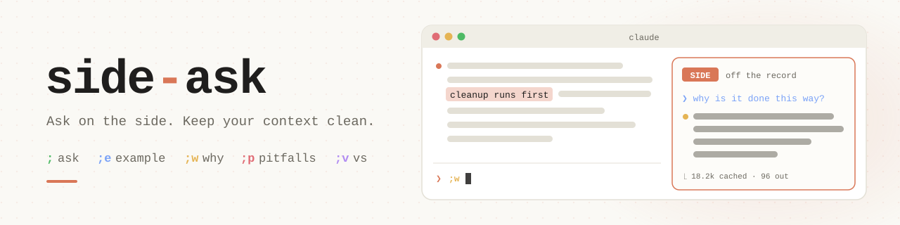
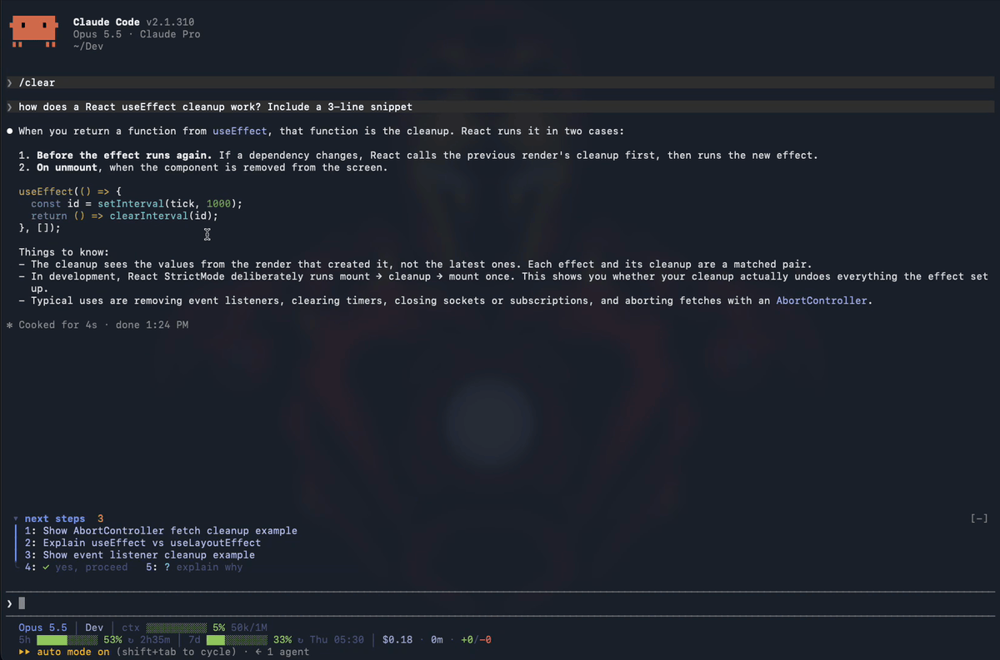

<div align="center">

<h1>claude-code-mods</h1>

**Small mods that change [Claude Code](https://claude.com/claude-code)'s own interface: panes, bands, prompt tricks and commands.**

[](LICENSE)
[](https://claude.com/claude-code)
[](#install)

</div>

## Install

Add the marketplace once, inside Claude Code:

```
/plugin marketplace add Analyst-Harsh/claude-code-mods
```

Then install any mod below with `/plugin install <mod>@claude-code-mods`, or from your shell with `claude plugin install <mod> --marketplace Analyst-Harsh/claude-code-mods`.

> [!NOTE]
> Mods need Claude Code **2.1.310** or newer. They're an early-access surface and may change between releases.

## Mods

### side-ask <sub>`0.7.0`</sub>

<div align="center">
<a href="side-ask/">
<picture>
  <source media="(prefers-color-scheme: dark)" srcset="side-ask/docs/banner-dark.svg">
  
</picture>
</a>
</div>

Select text in a reply, type `; question` and press **shift+enter**. The answer shows in a side pane and never enters the main conversation.

<div align="center">

</div>

`;` explain · `;e` example · `;w` why · `;p` pitfalls · `;v` vs · `;x` close

```
/plugin install side-ask@claude-code-mods
```

**[Read more →](side-ask/)** · [Changelog](CHANGELOG.md#side-ask) · [Release](https://github.com/Analyst-Harsh/claude-code-mods/releases/tag/side-ask-v0.7.0)

## Adding a mod

Put it in its own folder with a `.claude-plugin/plugin.json`, then add a line to `.claude-plugin/marketplace.json`:

```json
{ "name": "<mod>", "source": "./<mod>" }
```

Give it a `### <mod>` section under [Mods](#mods), with its banner, demo and install line. Record its notable changes in [CHANGELOG.md](CHANGELOG.md), and tag each release `<mod>-v<version>` (for example `side-ask-v0.7.0`), matching the `version` in its `plugin.json`.

<div align="center"><sub>MIT © Harshit Goyal</sub></div>
